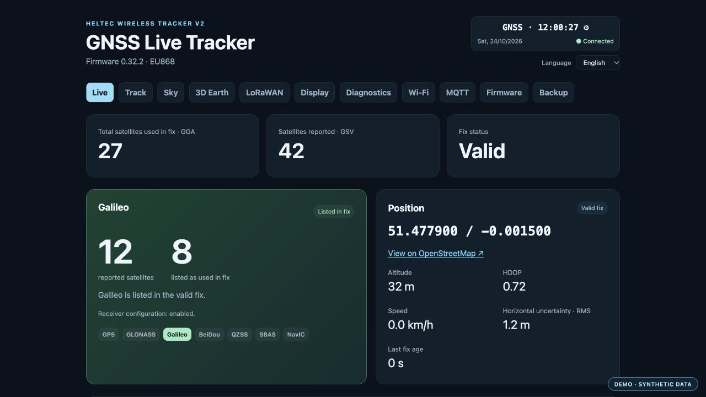
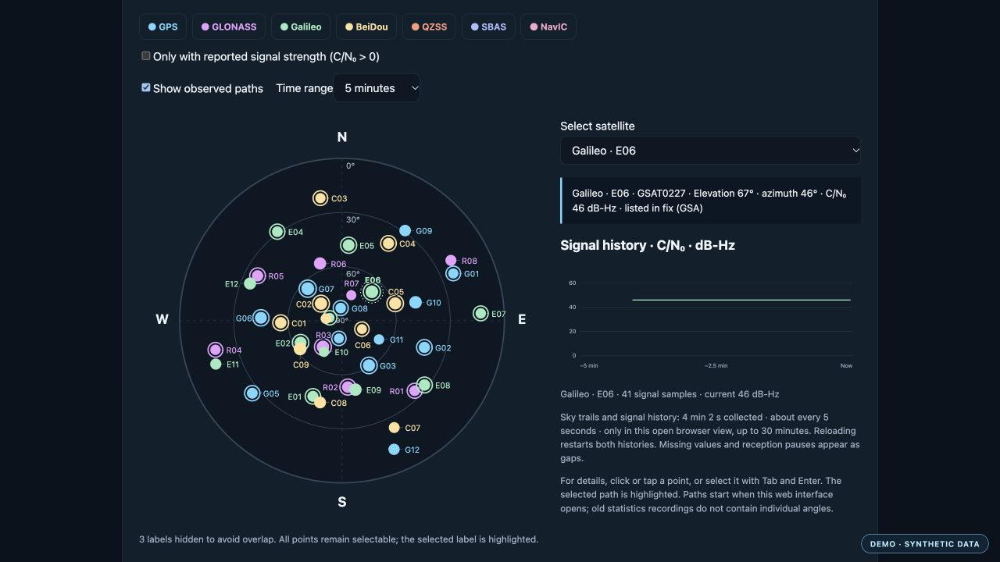
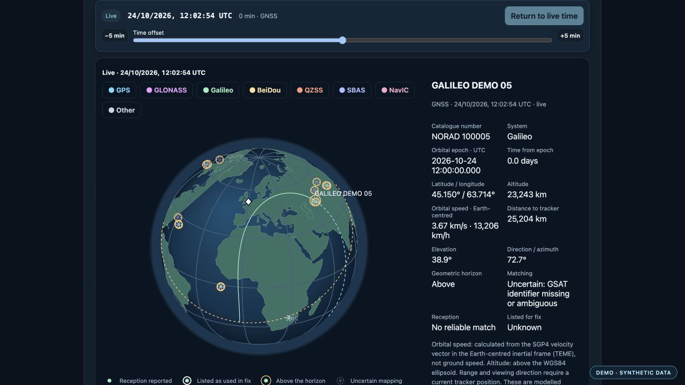
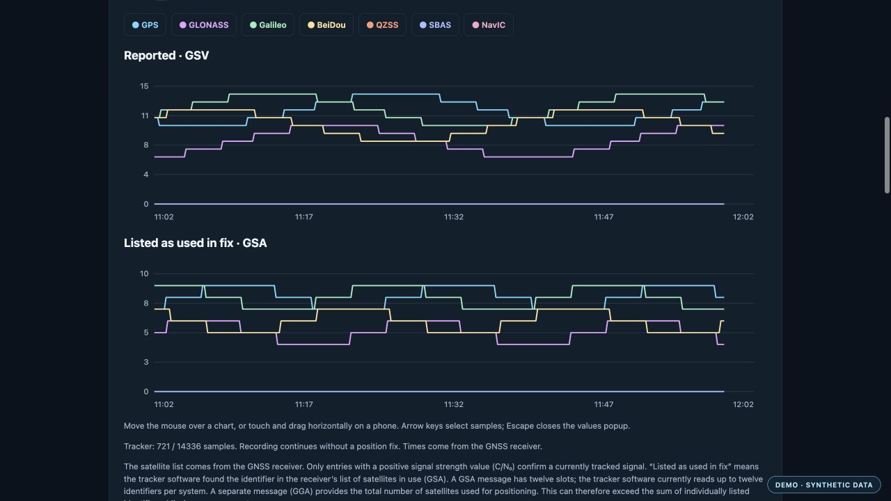

> [!WARNING]
> **Work in progress — testers welcome.**
> This project is under active development. Expect bugs, unfinished features and potentially unreliable behavior. Back up existing settings and recordings before testing. This is not a stable release.

# GNSS Live Tracker

GNSS tracking, satellite views and LoRaWAN for the **Heltec Wireless Tracker V2** — with a local web interface in English and German.

Based on [HTIT Tracker v1.2 for ESP-IDF](https://github.com/jbjardine/HTIT-Tracker-v1.2-forIDF), adapted and extended for the V2 hardware. **Using a Wireless Tracker V1.2? Please use the [original V1.2 project](https://github.com/jbjardine/HTIT-Tracker-v1.2-forIDF). This repository is for V2 boards.**

**[Download a preview](#download-a-preview)** · **[Setup · English](docs/INSTALL.en.md)** · **[Einrichtung · Deutsch](docs/INSTALL.de.md)** · **[Known limitations](docs/RELEASE-NOTES.md)**

Current preview: **0.32.2**. Maintained by [Nisbo](https://github.com/Nisbo).

## See your GNSS receiver at work

View the current position, fix quality and satellite systems. Record tracks and satellite statistics on the tracker, inspect signals in the sky view, or explore calculated satellite orbits in the browser.

The screenshots below show the English interface with **synthetic demo data**. The example position is a public reference near Greenwich, not a recorded tracker location. The orbit example also uses synthetic orbital elements. No personal network names, device identifiers or credentials are shown.

### Live dashboard

Position, satellite counts, fix status and signal-system selection in one overview.

<table>
  <tr>
    <td width="50%" valign="top">
      <h3>Sky view</h3>
      
Satellite direction and elevation, signal strength, observed paths and the selected satellite's signal history.

      
    </td>
    <td width="50%" valign="top">
      <h3>3D Earth &amp; ground tracks</h3>
      
Calculated orbits, time controls, horizon overlays and satellite details. Orbit calculations run in the browser.

      
    </td>
  </tr>
</table>

### Satellite history

Compare reported satellites and identifiers listed as used in the fix, separately for each system. Store the history on the tracker or in the browser, inspect individual samples and export CSV files.

*All four screenshots are illustrative demo captures. Open an image to view it at full size.*

## Features

| Area | What you can do |
| --- | --- |
| **GNSS** | View position, fix status, satellite systems, signal strength and receiver-reported uncertainty when available. |
| **Tracks & history** | Record position tracks and satellite-count history on the tracker independently of an open browser. Choose recording modes and intervals, view ring-buffer usage and export data. |
| **Sky & orbits** | Inspect the local sky view, signal history and observed paths. Import or download orbital data for 3D Earth and ground-track views. |
| **LoRaWAN** | Configure OTAA credentials, region, data rate, ADR, position interval and packet profile. Inspect uplinks, downlinks and ADR events. |
| **MQTT & Home Assistant** | Send telemetry and discovery messages to a broker, with optional credentials and a configurable port. Optionally allow recording and interval commands. |
| **Wi-Fi** | Save up to eight profiles, scan available networks and configure automatic fallback or a manual hotspot. |
| **Display** | Choose pages, automatic rotation, a clock page, brightness, timeout and USER-button behavior. |
| **Maintenance** | Update over Wi-Fi, back up selected settings and recordings, and inspect diagnostics. |

GNSS, display, local recording and the web interface work without a LoRaWAN account or gateway. LoRaWAN starts after you configure your own credentials. No personal Wi-Fi or LoRaWAN credentials are compiled into the firmware.

## Download a preview

The current downloads are **development builds from GitHub Actions**. A stable release has not been published yet.

1. Open **[V2 build and host checks](https://github.com/Nisbo/gnss-live-tracker/actions/workflows/build.yml)** and choose the latest successful run with a green checkmark.
2. Scroll to **Artifacts** and download **`gnss-live-tracker-v2-candidate`**. GitHub sign-in is required.
3. Unzip it. The versioned folder inside `dist/` contains the installation and update files, decoder, documentation and checksums.

| File | Use |
| --- | --- |
| **`gnss-live-tracker-vVERSION.ota.bin`** | Update an existing installation using the tracker's **Firmware** tab. Preserves settings and recordings. |
| **`gnss-live-tracker-vVERSION.factory.bin`** | First installation over USB, for example with **[ESPHome Web](https://web.esphome.io/)**. Replaces **all settings and recordings**. |
| `ttn-decoder.js` | The shared TTN decoder for all supported packet profiles. |
| `SHA256SUMS` / `release.json` | Checksums, firmware version, board target and validation information. |

> [!IMPORTANT]
> Use the **OTA image** to update a configured tracker. The 8 MiB factory image includes blank user-storage areas and is intended for a fresh installation.

Follow the complete **[English setup guide](docs/INSTALL.en.md)** or **[deutsche Anleitung](docs/INSTALL.de.md)** for installation, first Wi-Fi access and TTN setup.

## Hardware

  
   
  Product image: Heltec Automation, externally hosted.

Target board: **Heltec Wireless Tracker V2**, with an ESP32-S3, 8 MiB flash, SX1262 LoRa radio, UC6580 GNSS receiver and 160 × 80 TFT display.

- **[Heltec product page](https://heltec.org/project/wireless-tracker-v2/)** — board details and manufacturer resources.
- **[Amazon.de listing](https://www.amazon.de/dp/B0GVMLSVYV)** — retailer link.

Check the board revision before installation. ESP Web Tools recognizes the ESP32 chip family, not the exact Heltec board. This firmware targets the V2, not V1.x boards.

**EU868 is field-tested. Every other selectable region is experimental and has not been tested over the air.** See [regional plans](docs/REGIONS.md). The inherited LoRaWAN stack implements version 1.0.2; this project does not claim LoRaWAN certification.

## Before you test

- **Validation:** clean USB installation and a complete recording-data restore still need physical acceptance testing. See the [current validation status](docs/RELEASE-NOTES.md).
- **Browser data:** map tiles and downloaded orbit catalogues need Internet access in the viewing browser. Ordinary GNSS, display and local recording do not.
- **Backups:** backup files are unencrypted and can contain credentials and recorded locations. Keep them private; read [security and data handling](docs/SECURITY.md).

Found a problem? [Open an issue](https://github.com/Nisbo/gnss-live-tracker/issues) with the firmware version, board revision, selected region and steps to reproduce it. Remove credentials, network identifiers and precise personal locations from anything you share.

## Documentation

| Guide | Contents |
| --- | --- |
| [Install & set up · English](docs/INSTALL.en.md) / [Deutsch](docs/INSTALL.de.md) | First installation, Wi-Fi and TTN setup |
| [Build from source](docs/BUILD.md) | ESP-IDF v5.4, host tests and release packaging |
| [Troubleshooting](docs/TROUBLESHOOTING.md) | Connection, GNSS, radio and update problems |
| [Wi-Fi & Internet checks](docs/NETWORK.md) | Profiles, hotspot modes and Internet-status reporting |
| [Regions](docs/REGIONS.md) | Supported regional plans and experimental status |
| [Validation & limitations](docs/RELEASE-NOTES.md) | What has and has not been tested |
| [Changelog](CHANGELOG.md) | Changes between preview versions |
| [Project origin & notices](docs/UPSTREAM.md) | V1.2 provenance and third-party components |

Developers can build from the repository root with `idf.py build` or `scripts/build-v2.sh`. The repository includes the V2 application, required drivers, web assets, decoder and host tests. ESP-IDF and compiler/OS tools are external dependencies.

## Origin and license

Based on Jean-Baptiste Robert-Jardine's [HTIT Tracker v1.2 for ESP-IDF](https://github.com/jbjardine/HTIT-Tracker-v1.2-forIDF), starting from commit `9a7a9210a124d1c100d1dc97bfd4efedd5c4ea8b`. This is a V2 derivative, not an official Heltec firmware release. The original Apache-2.0 license and copyright notices are retained. Additional component licenses apply; see [LICENSE](LICENSE), [NOTICE](NOTICE) and [UPSTREAM](docs/UPSTREAM.md).
